<a href="https://www.bmrauf.me">
  <picture>
    <source media="(prefers-color-scheme: dark)" srcset="assets/hero-dark.svg" />
    <source media="(prefers-color-scheme: light)" srcset="assets/hero-light.svg" />
    
  </picture>
</a>

  
  
  

<i>“Always dreaming of winning.”</i>

I'm **Rauf**, a Computer Science and Engineering graduate from **BRAC University**. I often start by solving a problem in my own life. Sometimes that becomes a useful application; sometimes it takes me deeper into **systems** or **machine learning**.

I care about more than whether something works on paper. When I build software, I question the assumptions, look for where things fail, and check whether the solution works for the people using it. In ML experiments, that means looking past accuracy to precision, false positives and performance across different conditions.

→ <a href="https://www.bmrauf.me/behind-the-code">More about me</a>

## Projects

### &nbsp; [Circuvo](https://circuvo-azrova.vercel.app/)
FEATURED &nbsp;·&nbsp; WEB APP &nbsp;·&nbsp; TOP 15 AT BRAIN CHILD 2.0

A marketplace for recyclable waste, with AI-assisted features. Built with team AzRova and placed in the Top 15 at the national project expo, Jagannath University AI &amp; IT Fest 2026.

Next.js · TypeScript · Express · PostgreSQL &nbsp;·&nbsp; <a href="https://circuvo-azrova.vercel.app/">Visit site ↗</a>

### &nbsp; [Khabari](https://khabari.bmrauf.me)
WEB APP &nbsp;·&nbsp; ENGLISH + বাংলা

A bazar app built around the neighbourhood mudi shop. Plan meals with AI, turn them into one list, compare nearby shops on that exact list, and order in one tap. Includes baki khata, rider tools and mess hisab.

AI meal planning · Price comparison · Bilingual &nbsp;·&nbsp; <a href="https://khabari.bmrauf.me">Visit site ↗</a>

### &nbsp; [Bookworm Buddies](https://bookwormbuddies.bmrauf.me)
COMMUNITY PLATFORM

A free community where readers in Bangladesh lend, swap and give away physical books. Browse without an account, request a book, arrange the handover in private chat, and blog about what you read.

Book exchange · Private chat · Blog &nbsp;·&nbsp; <a href="https://bookwormbuddies.bmrauf.me">Visit site ↗</a>

### &nbsp; [MiniVSFS](https://github.com/mebmrauf/MiniVSFS)
SYSTEMS &nbsp;·&nbsp; C

Two C programs: one builds a small inode-based file-system image, the other adds a file to it. Superblocks, allocation bitmaps, directory entries and checksums, down to the bytes on disk.

C · File systems · Inodes &nbsp;·&nbsp; <a href="https://github.com/mebmrauf/MiniVSFS">View code ↗</a>

### &nbsp; [Facial Emotion Recognizer](https://github.com/mebmrauf/Facial-Emotion-Recognizer)
DEEP LEARNING &nbsp;·&nbsp; COMPUTER VISION

ResNet-34 with spatial attention, trained on AffectNet and fine-tuned on FER2013. Per-class evaluation and misclassification plots show where the model gets confused.

PyTorch · ResNet-34 · Attention &nbsp;·&nbsp; <a href="https://github.com/mebmrauf/Facial-Emotion-Recognizer">View code ↗</a>

More: <a href="https://github.com/mebmrauf/Mushroom-Class-Detector">Mushroom classification</a> · <a href="https://github.com/mebmrauf/Air-Quality-Predictor">Air-quality classification</a> · <a href="https://www.bmrauf.me/code-and-craft">Full portfolio ↗</a>

## Tech Stack

  

**Software** &nbsp;·&nbsp; TypeScript · JavaScript · React · Next.js · Node.js · Express.js · SQL · MongoDB 
**Machine learning** &nbsp;·&nbsp; Python · PyTorch · scikit-learn · snnTorch · NumPy · Pandas 
**Systems** &nbsp;·&nbsp; C · Assembly

## Research

### &nbsp; [Edge IoT IDS Benchmark](https://github.com/mebmrauf/edge-iot-ids-benchmark)
CO-AUTHORED &nbsp;·&nbsp; MACHINE LEARNING

How do intrusion detectors hold up when every IoT device sees a different slice of the network? We compare tree ensembles, neural networks and spiking networks across four IoT security datasets, with 15 simulated federated clients and varying label skew.

Federated learning · Spiking networks · Non-IID data &nbsp;·&nbsp; <a href="https://github.com/mebmrauf/edge-iot-ids-benchmark">View code ↗</a>

---

Away from code: photography, movies and time with friends. Sleep is a feature.

  <b>Open to software engineering and AI/ML opportunities.</b> 
  Have a role or a project in mind? <a href="mailto:bmrauf.me@gmail.com">Send me a note →</a>

<i>“Every expert was once a beginner.”</i>

