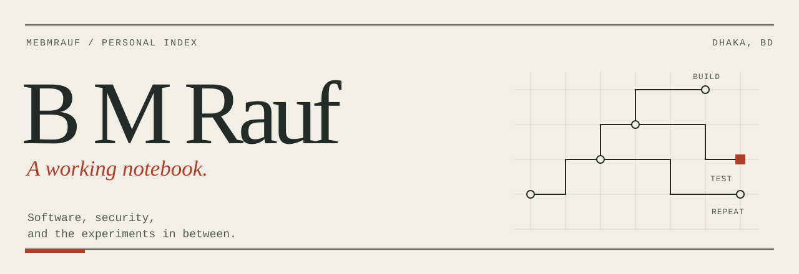

  

[Portfolio](https://www.bmrauf.me) &nbsp; / &nbsp; [LinkedIn](https://www.linkedin.com/in/mebmrauf) &nbsp; / &nbsp; [Email](mailto:bmrauf.me@gmail.com)

> **Always dreaming of winning.**

I am Rauf, a Computer Science and Engineering graduate from BRAC University. I often start by solving a problem in my own life. Sometimes that becomes a useful application; sometimes it takes me deeper into systems, machine learning or cybersecurity.

Accuracy alone isn't enough. In research, I look at precision, false positives and performance across different conditions. When building software, I bring the same habit: question the assumptions, understand where things fail, and check whether the solution works for the people using it.

[More about me →](https://www.bmrauf.me/behind-the-code)

### 01 / The question on my desk

**What happens to an intrusion detector when every device sees a different slice of the network?**

In [edge-iot-ids-benchmark](https://github.com/mebmrauf/edge-iot-ids-benchmark), we compare tree ensembles, neural networks and spiking networks across four IoT security datasets, with 15 simulated federated clients and varying label skew. The repository includes the processed splits, trained models and results behind our paper.

Co-authored research · Submitted to <i>Internet of Things</i> (Elsevier), 2026.

### 02 / Things I've put together

#### [Circuvo ↗](https://circuvo.bmrauf.me/)

A marketplace for recyclable waste, with AI-assisted features. Built with Next.js, TypeScript, Express and PostgreSQL. Our team, AzRova, reached the **Top 15 at BRAIN CHILD 2.0**, the national project expo at Jagannath University AI & IT Fest 2026.

#### [Khabari ↗](https://khabari.bmrauf.me)

A bazar app for Bangladesh, built around the neighbourhood mudi shop people already trust. Plan the week's meals with AI, turn them into one bazar list, compare nearby shops on that exact list, and order in one tap, in English or বাংলা. It also has baki khata and rider tools for shopkeepers, and mess hisab for bachelor messes.

#### [MiniVSFS ↗](https://github.com/mebmrauf/MiniVSFS)

Two C programs: one builds a small inode-based file-system image; the other adds a file to it. Superblocks, allocation bitmaps, directory entries and checksums, down to the bytes on disk.

#### [Facial Emotion Recognizer ↗](https://github.com/mebmrauf/Facial-Emotion-Recognizer)

ResNet-34 with spatial attention, trained on AffectNet and fine-tuned on FER2013. Includes per-class evaluation and misclassification plots, so you can see where the model gets confused.

Other experiments: <a href="https://github.com/mebmrauf/Mushroom-Class-Detector">mushroom classification</a> · <a href="https://github.com/mebmrauf/Air-Quality-Predictor">air-quality classification</a> · <a href="https://www.bmrauf.me/code-and-craft">more work on my portfolio</a>

### 03 / What's in the toolbox

**Software** &nbsp; TypeScript, JavaScript, React, Next.js, Node.js, Express.js, SQL, MongoDB 
**Experiments** &nbsp; Python, PyTorch, scikit-learn, snnTorch, NumPy, Pandas 
**Closer to the machine** &nbsp; C, Assembly

---

Away from code: photography, movies, and time with friends. Sleep is a feature.

**Open to software engineering, AI/ML and cybersecurity opportunities.** 
Have a role or a project in mind? [Send me a note](mailto:bmrauf.me@gmail.com).

> **Every expert was once a beginner.**
